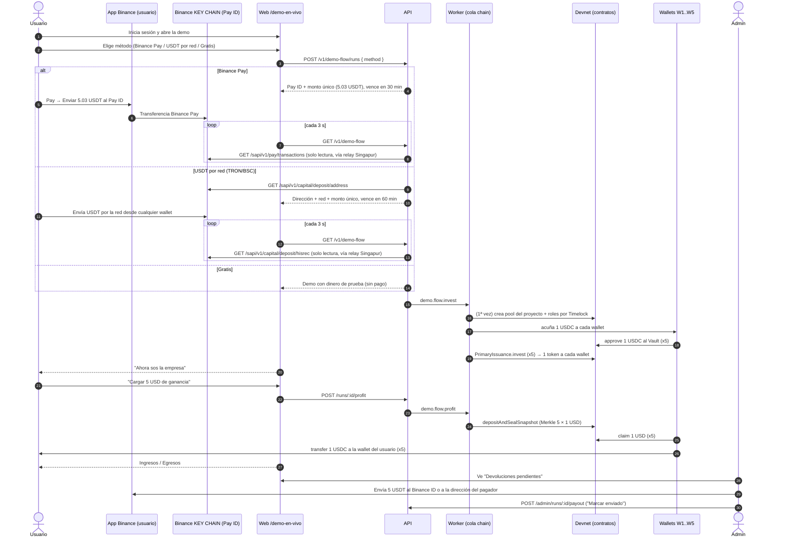
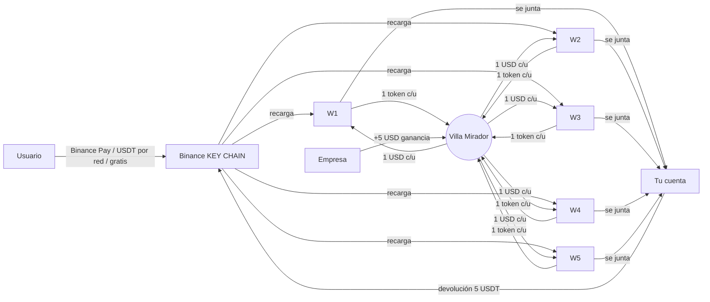

# KEY CHAIN — Demo en vivo "Villa Mirador" (flujo completo)

Documento fuente para generar diagramas del flujo del proyecto destacado. Estado al 2026-11-17.

## 1. Resumen

Proyecto de prueba **Villa Mirador** (5 tokens a 1 USD) que cualquier usuario logueado puede recorrer de punta a punta en `/demo-en-vivo`:

1. Inicia sesión (Google, Apple, Facebook, número o wallet externa).
2. Elige cómo recargar:
   - **Binance Pay**: envía ~5 USDT reales al Pay ID de KEY CHAIN desde la app de Binance.
   - **USDT desde cualquier wallet**: envía ~5 USDT por red **TRON (TRC20)** o **BNB Smart Chain (BEP20)** a la dirección de depósito de Binance de KEY CHAIN, desde cualquier exchange o wallet.
   - **Gratis**: recorre todo con dinero de prueba, sin pago ni devolución.
3. **5 wallets** (custodiadas por la plataforma) reciben 1 USDC cada una y compran 1 token cada una.
4. El usuario actúa como **empresa** y carga **5 USD de ganancia**.
5. La ganancia se reparte: **1 USD a cada wallet** (dividendo Merkle on-chain).
6. Las 5 wallets envían lo cobrado a la **wallet del usuario**: "se junta todo en tu cuenta".
7. Si pagó con dinero real, un admin le **devuelve 5 USDT reales** (a su Binance ID o a la dirección que dejó).
8. La pantalla muestra **Ingresos / Egresos**.

## 2. Actores y sistemas

| Actor / sistema | Rol |
|---|---|
| Usuario | Paga con Binance, dispara la ganancia como empresa, ve el reparto |
| App de Binance del usuario | Envía USDT por Binance Pay (Pay → Enviar → Pay ID) |
| Exchange / wallet del usuario | Envía USDT por red TRON o BSC a la dirección de depósito (opción "cualquier wallet") |
| Cuenta Binance personal de KEY CHAIN | Recibe el pago; API key **solo lectura** para leer el historial de Pay y de depósitos, y la dirección de depósito |
| Frontend web (`key-chain`, ruta `/demo-en-vivo`) | Página gráfica: fotos, diagrama animado, 5 pasos, ingresos/egresos, panel admin |
| API (`key-chain-api`, NestJS, servicio Railway `api`) | Endpoints `/v1/demo-flow`, detecta el pago en Binance, encola jobs |
| Binance relay (servicio Railway `binance-relay`, región Singapur) | Binance bloquea IPs de EE.UU.: la API llama a Binance a través de este servicio privado, que solo reenvía las 3 consultas de lectura (la firma la hace la API) |
| Worker (servicio Railway `worker`) | Ejecuta los jobs on-chain en la cola `chain` (un solo firmante) |
| Postgres | Tabla `demo_runs` (estado + pasos), `dividend_snapshots`, auditoría |
| Redis / BullMQ | Cola `chain` con jobs `demo.flow.invest` y `demo.flow.profit` |
| Devnet KEY CHAIN (chain 202610, servicio `devnet`) | Red privada de pruebas con MockUSDC y los contratos del protocolo |
| Contratos del pool del proyecto | `PrimaryIssuance`, `Vault`, token ERC-3643 `KC{id}`, `DividendDistributor` |
| 5 wallets demo (W1…W5) | Claves derivadas del firmante del backend; verificadas en el IdentityRegistry |
| Admin | Envía la devolución desde su app de Binance y la marca como enviada |

## 3. Estados de una demo (`DemoRunStatus`)

```
awaiting_payment ──(pago detectado en Binance)──▶ investing ──(5 compras ok)──▶ invested
       │                                               │                           │
       │(30 min sin pago)                              │(error)                    │(usuario: "Cargar 5 USD de ganancia")
       ▼                                               ▼                           ▼
    expired                                          failed ◀──────(error)──── distributing ──(reparto ok)──▶ completed
                                                       │                                                        │
                                                       └──(usuario: "Reintentar", retoma donde quedó)            └─(admin marca devolución) paso "payout"
```

- Opción **Gratis** (o sin claves de Binance configuradas): la demo nace directo en `investing`, sin cobro ni devolución.
- `failed` → "Reintentar" vuelve a `investing` o `distributing` según cuántos pasos ya se hicieron; los pasos registrados se saltan (idempotente).

## 4. Secuencia detallada

### 4.1 Recarga (estado `awaiting_payment`)
1. Usuario elige el método y toca el botón → `POST /v1/demo-flow/runs` con `{ method: 'binance_pay' | 'crypto' | 'free' }` (crypto agrega `network` TRX/BSC y `refundAddress`, validada según la red).
2. API crea `DemoRun` con un **monto único**: precio + centavos aleatorios no usados por otra demo en espera (ej. `5.03 USDT`). Vence en **30 min** (Binance Pay) o **60 min** (depósito por red).
3. La página muestra los datos con botón copiar:
   - Binance Pay: **Pay ID** + **monto exacto** (Binance → Pay → Enviar → Pay ID).
   - Cualquier wallet: **dirección de depósito** (leída de `GET /sapi/v1/capital/deposit/address`) + **red** + **monto exacto**.
4. El usuario envía el pago.
5. La página consulta `GET /v1/demo-flow` cada 3 s. La API (key solo lectura, caché de 8 s compartida) busca el **monto exacto** posterior a la creación y no usado:
   - Binance Pay: `GET /sapi/v1/pay/transactions` (USDT, monto positivo).
   - Depósito: `GET /sapi/v1/capital/deposit/hisrec` (USDT, misma red, estado acreditado).
6. Si coincide: guarda `binanceTxId` (único; los depósitos como `dep:<id>`) y, en Binance Pay, `payerId`; pasa a `investing` y encola `demo.flow.invest`.

### 4.2 Inversión desde 5 wallets (job `demo.flow.invest`, estado `investing`)
1. Primera vez: crea el activo borrador "Villa Mirador — Proyecto demo" (no aparece en el catálogo), despliega su pool por la Factory y otorga roles por Timelock. Verifica las 5 wallets en el IdentityRegistry y les da gas.
2. Por cada wallet Wi: el backend acuña **1 USDC de prueba** a Wi (paso `fund:i`).
3. Cada Wi aprueba 1 USDC al Vault (5 transacciones en paralelo, paso `approve:i`).
4. El backend (rol ENGINE) llama `PrimaryIssuance.invest(Wi, USDC, 1)` → el Vault toma 1 USDC y se acuña **1 token** a Wi (paso `invest:i`).
5. Estado `invested`.

### 4.3 La empresa carga la ganancia (estado `invested` → `distributing`)
1. La página dice "Ahora sos la empresa" → botón **"Cargar 5 USD de ganancia"** → `POST /v1/demo-flow/runs/:id/profit` → encola `demo.flow.profit`.
2. Job: calcula el bruto para que el **neto después del fee de rendimiento = 5 USD**, acuña ese USDC al backend (la "empresa"), aprueba fee y neto, y llama `DividendDistributor.depositAndSealSnapshot(snapshotId, merkleRoot, bruto)` con un árbol Merkle de **5 hojas de 1 USD** (paso `deposit`).

### 4.4 Reparto a las 5 wallets
1. Cada Wi llama `DividendDistributor.claim(snapshotId, 1 USD, proof)` en paralelo → recibe 1 USDC (paso `claim:i`).
2. Cada Wi transfiere 1 USDC a la **wallet del usuario** en paralelo (paso `sweep:i`).
3. Estado `completed`. La wallet del usuario tiene **+5 USDC** en la devnet.

### 4.5 Devolución real a Binance (manual, admin)
1. En `/demo-en-vivo`, los admins ven **"Devoluciones pendientes"**: lo que pagó, lo que hay que devolver (5 USDT) y a dónde: Binance ID (Binance Pay) o dirección + red (depósito).
2. El admin envía 5 USDT desde su Binance: Pay → Enviar al Binance ID, o Retirar USDT a la dirección por esa red.
3. Toca **"Marcar enviado"** → `POST /v1/demo-flow/admin/runs/:id/payout` → se agrega el paso `payout` (una sola vez) y queda en la auditoría.

### 4.6 Ingresos / Egresos (lo que ve el usuario)
| Movimiento | Dónde | Monto | Tipo |
|---|---|---|---|
| Pago con Binance Pay / Depósito de USDT / Recarga de prueba | Dinero real o simulado | −5.0x USDT | Egreso |
| Inversión: 5 tokens × 1 USD | On-chain (la recarga pasa a tokens) | 5 → 5 tokens | Conversión (no suma) |
| Ganancia repartida (5 × 1 USD) | On-chain, llega a tu wallet | +5 USD | Ingreso |
| Devolución a tu Binance / a tu wallet | Dinero real (pendiente hasta que el admin la marque; no aparece en la demo gratis) | +5 USDT | Ingreso |

## 5. Diagrama de la pantalla (lo que anima el frontend)

Nodos: **Binance** (amarillo; "Recarga" en la demo gratis), **W1…W5** (columna central), **Villa Mirador** (círculo con foto), **Empresa**, **Tu cuenta**.

| Arista | Fase | Color |
|---|---|---|
| Binance → Wi | Recarga (fund) | negro |
| Wi → Villa Mirador | Inversión | negro |
| Empresa → Villa Mirador | Depósito de la ganancia | verde |
| Villa Mirador → Wi | Cobro del dividendo (claim) | verde |
| Wi → Tu cuenta | Se junta todo (sweep) | verde |
| Tu cuenta → Binance | Devolución real | verde |

Solo se dibuja lo que está pasando (con partículas animadas) y, tenue, lo que ya pasó. Antes de pagar se ven todas las conexiones punteadas.

## 6. Diagrama Mermaid de referencia





## 7. Endpoints

| Método | Ruta | Quién | Qué hace |
|---|---|---|---|
| GET | `/v1/demo-flow` | usuario | Estado: disponible, modo prueba, Pay ID, precio, wallets, demo actual (y chequea el pago) |
| POST | `/v1/demo-flow/runs` | usuario | Crea la demo (`method`: binance_pay, crypto o free; `tokens`: 1–5 partes, por defecto 5) o devuelve la activa. El usuario paga y recibe `tokens` USD; W1..W{tokens} son suyas y el resto son "otros inversionistas" que se quedan su ganancia |
| POST | `/v1/demo-flow/runs/:id/profit` | usuario | La empresa carga la ganancia |
| POST | `/v1/demo-flow/runs/:id/retry` | usuario | Reintenta una demo fallida desde donde quedó |
| POST | `/v1/demo-flow/runs/:id/cancel` | usuario | Cambia el método de pago: una demo que espera pago pasa a `expired` (si el pago ya llegó, sigue normal) |
| GET | `/v1/demo-flow/admin/payouts` | admin | Devoluciones pendientes |
| POST | `/v1/demo-flow/admin/runs/:id/payout` | admin | Marca la devolución como enviada |

## 8. Configuración (Railway, servicio `api`)

| Variable | Valor |
|---|---|
| `BINANCE_API_KEY` / `BINANCE_API_SECRET` | API key HMAC **solo lectura** de la cuenta personal (Pay, depósitos y dirección de depósito) |
| `BINANCE_PAY_ID` | Pay ID que se muestra al usuario |
| `BINANCE_BASE_URL` | `http://binance-relay.railway.internal:8080` (el relay de Singapur) |
| `DEMO_FLOW_PRICE_USDT` | 5 (precio base; se suman centavos únicos) |
| `DEMO_FLOW_PAYOUT_USDT` | 5 (devolución real) |

Sin las tres variables de Binance solo se ofrece la opción **Gratis**. Con ellas aparecen las tres opciones.

## 9. Archivos

- Relay: `key-chain-api/binance-relay/relay.mjs`.
- API: `key-chain-api/src/modules/demo-flow/demo-flow.module.ts`, `src/chain/demo-flow.service.ts`, `src/infra/binance-pay.ts`, migraciones `prisma/migrations/20261117120000_demo_runs` y `20261117170000_demo_run_methods`.
- Frontend: `key-chain/app/features/demo-flow/` (`DemoFlow.tsx`, `FlowDiagram.tsx`, `FeaturedDemoCard.tsx`, `AdminPayouts.tsx`, `api.ts`), ruta `app/routes/demo-en-vivo.tsx`, fotos en `public/images/demo-flow/1..5.webp`.
- Entrada destacada: tarjeta "Destacado" con borde dorado animado en `/tokenizaciones`.
